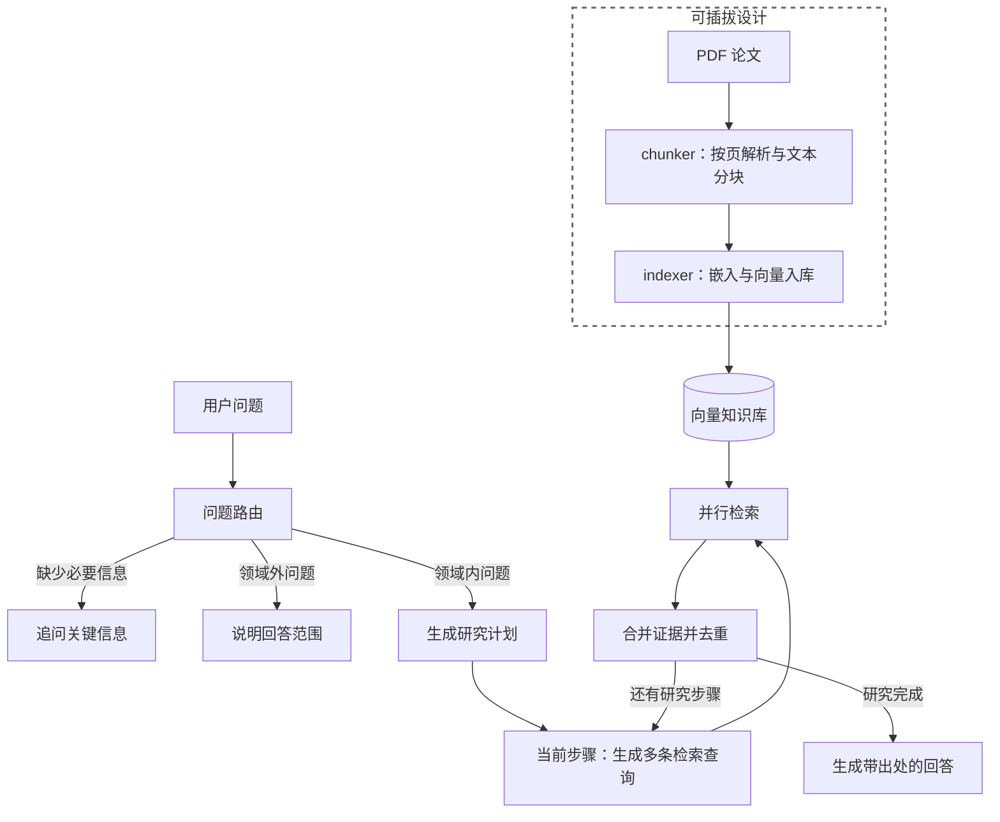

# PaperMind：科研文献 RAG 问答系统

基于 **LangGraph + LangChain** 的科研文献检索增强问答系统。将本地 PDF 论文解析、分块并写入向量库，再通过问题路由、研究计划和多查询并行检索组织证据，生成带文献出处与页码的回答。

PaperMind 最初克隆自 LangChain 官方的 LangGraph 基础模板 [retrieval-agent-template](https://github.com/langchain-ai/retrieval-agent-template.git)，并在此基础上扩展，重点实现了论文处理、本地嵌入与持久化索引、可替换的文献格式处理与分块策略，以及检索端和回答端的评测流程。当前默认知识领域为**图像超分辨与算子学习 / 神经算子**，适合围绕个人论文库开展方法分析、实验结论查询和跨论文比较。

## 核心能力

- **论文处理**：使用 PyMuPDF 按页提取 PDF 文本，过滤短碎片与参考文献部分，保留来源、页码等元数据；默认递归分块不跨页。
- **本地向量索引**：通过 sentence-transformers 运行嵌入模型，默认使用本地 Chroma 持久化存储。Chroma 入库以片段内容的 MD5 作为 ID，重复提交相同内容时执行 upsert。
- **问题路由**：区分可检索的领域问题、需要补充信息的问题，以及领域外问题，分别进入研究、追问或婉拒路径。
- **研究计划与并行检索**：将复杂问题拆成最多 5 个研究步骤，逐步执行；每步由模型生成多条查询，再通过 LangGraph `Send` 并行检索、合并去重。默认提示词要求每步生成 3 条查询。
- **基于证据回答**：将检索片段及元数据交给回答模型，提示其引用来源与页码，并在证据不足时明确说明。
- **过程可观察**：可流式查看主图的研究步骤、检索文档，以及研究子图生成的查询。
- **评测工具**：支持单篇 / 跨论文问题的证据覆盖评测，以及回答相关性、证据支持程度和引用质量的模型评审。

## 系统结构



`langgraph.json` 注册了三个可独立调用的图：`chunker`、`indexer`、`retrieval_graph`。研究子图 `researcher_graph` 由问答主图内部调用，不单独注册服务。

## 快速开始

### 1. 安装环境

项目声明支持 Python 3.10+。在仓库根目录执行：

```bash
python -m venv .venv
```

激活虚拟环境：

```powershell
# Windows PowerShell
.\.venv\Scripts\Activate.ps1
```

```bash
# macOS / Linux
source .venv/bin/activate
```

安装项目：

```bash
python -m pip install -e .
```

### 2. 配置模型与论文

将 [.env.example](.env.example) 复制为 `.env`，填写所需服务的密钥。使用 Qwen 时只需为对应模型配置：

```dotenv
QWEN_API_KEY=your-dashscope-api-key
```

Qwen 通过 DashScope 的 OpenAI 兼容接口调用。其他模型由 LangChain 模型接口加载，使用时需配置相应服务的凭据。

准备一份含可提取文本的 PDF，例如 `papers/sample.pdf`。论文文件、`.env` 和本地向量库已被 Git 忽略，需要在克隆仓库后自行准备。

**嵌入模型需要显式配置。** 当前代码默认值为开发机器上的 `E:/python_work/PDFReader_Agent/bge-m3`，通常无法在其他机器直接使用。下面示例将其覆盖为 `BAAI/bge-m3`，首次运行需要下载模型；也可以改为已下载模型的本地目录。入库与问答必须使用相同的嵌入模型、向量库目录和 collection。

### 3. 运行完整问答链路

将以下代码保存为仓库根目录的 `quickstart.py`。示例显式选择 `qwen/qwen-plus`，实际模型名称应以你的 DashScope 账号可用列表为准。

```python
import asyncio
from pathlib import Path

from chunk_graph import graph as chunker
from index_graph import graph as indexer
from retrieval_graph import graph as agent
from shared.utils import chat_client_session


async def main():
    config = {
        "configurable": {
            "retriever_provider": "chroma",
            "embedding_model": "BAAI/bge-m3",  # 或本地模型目录
            "embedding_device": "cpu",        # 有可用 CUDA 环境时可改为 cuda
            "chroma_path": "./chroma_db",
            "chroma_collection": "langchain_index",
            "search_kwargs": {"k": 8},
            "query_model": "qwen/qwen3.8-max",
            "response_model": "qwen/qwen3.8-max",
            "splitter_configuration": {
                "chunk_size": 512,
                "chunk_overlap": 64,
            },
        }
    }

    chunked = await chunker.ainvoke(
        {"source": str(Path("papers/sample.pdf").resolve())}, config
    )
    if not chunked["chunks"]:
        raise RuntimeError("未提取到有效文本，请检查 PDF 是否含可提取的文本层。")

    await indexer.ainvoke({"docs": chunked["chunks"]}, config)

    result = await agent.ainvoke(
        {"messages": [("user", "SRNO 如何将神经算子用于图像超分辨？")]},
        config,
    )
    print(result["messages"][-1].content)


if __name__ == "__main__":
    async def run():
        async with chat_client_session():
            await main()

    asyncio.run(run())
```

```bash
python quickstart.py
```

`chat_client_session()` 为本次 Qwen 问答共享 HTTP 客户端，并在退出前显式关闭连接，避免 Windows 下连接延迟回收导致的 `Event loop is closed`。完整的图调用或流式迭代应在该上下文内完成。

请将示例问题替换为所导入论文确实涉及的问题。更换研究领域时，也需要调整 [prompts.py](src/retrieval_graph/prompts.py) 中的领域路由提示词，或通过运行时的 `router_system_prompt` 覆盖它。

### 4. 查看研究过程

如需观察每个节点的输出，可用以下代码替换示例中的问答调用：

```python
async for namespace, update in agent.astream(
    {"messages": [("user", "SRNO 如何将神经算子用于图像超分辨？")]},
    config,
    stream_mode="updates",
    subgraphs=True,
):
    print("[主图]" if not namespace else "[研究子图]", update)
```

主图输出包含路由、研究步骤与汇总文档；子图输出包含查询和各次检索结果。`queries` 位于子图中，需要开启 `subgraphs=True` 才便于观察。

## 运行时配置

配置优先级：运行时 `config["configurable"]` > `PAPERMIND_*` 环境变量 > 代码内置默认值。项目会加载 `.env`，不覆盖已有系统环境变量。可将 `.env.example` 中的 `PAPERMIND_*` 配置复制到 `.env`，之后调用图时可省略 `config`。`PAPERMIND_SEARCH_KWARGS` 和 `PAPERMIND_SPLITTER_CONFIGURATION` 必须是 JSON 对象；运行时同名字典整体替换环境值，不递归合并。修改 `.env` 后请重启进程。

| 参数 | 当前代码默认值 | 用途 |
| --- | --- | --- |
| `retriever_provider` | `chroma` | 向量存储后端 |
| `embedding_model` | `E:/python_work/PDFReader_Agent/bge-m3` | sentence-transformers 模型名或本地路径 |
| `embedding_device` | `cpu` | 嵌入推理设备 |
| `chroma_path` | `./chroma_db` | 本地持久化目录 |
| `chroma_collection` | `langchain_index` | Chroma collection 名称 |
| `search_kwargs` | `{"k": 8}` | 每条查询的检索参数 |
| `query_model` | `qwen/qwen3.7-plus` | 路由、研究规划、查询生成及追问 / 领域外回复模型 |
| `response_model` | `qwen/qwen3.7-plus` | 基于检索证据生成最终回答的模型 |
| `loader_provider` | `pdf` | 文档加载策略 |
| `splitter_provider` | `recursive` | 文本分块策略 |
| `splitter_configuration` | `chunk_size=512`、`chunk_overlap=64` | 分块策略私有参数，默认按字符计数 |
| `min_chunk_words` | `0` | 可选的最小词数过滤，按空白分词 |
| `max_upload_bytes` | 不限制 | 传入 PDF 字节数据时的可选大小限制 |

模型默认值来自当前源码，不代表服务端一定提供同名模型；建议像快速开始示例一样显式配置可用型号。

向量后端还支持 `elastic-local`、`elastic`、`pinecone`、`mongodb`，相关连接变量见 [.env.example](.env.example)。默认本地 Chroma 路径不需要额外部署数据库服务。

## 本地 API 服务

`langgraph dev` 的内存开发服务需要 **Python 3.11+**。Python 3.10 可运行前文的 Python 图调用示例，但不能运行当前版本的内存开发服务。

如需通过本地 API 调用三个图，请在 Python 3.11+ 虚拟环境中安装项目和 CLI：

```bash
python --version
python -m pip install -e .
python -m pip install "langgraph-cli[inmem]"
langgraph dev
```

已有 Python 3.10 环境的 Windows 用户，可在安装 Python 3.11 后创建独立环境，保留原 `.venv`：

```powershell
py -3.11 -m venv .venv-api
.\.venv-api\Scripts\python.exe -m pip install --upgrade pip
.\.venv-api\Scripts\python.exe -m pip install -e . "langgraph-cli[inmem]"
$env:PYTHONUTF8 = "1"
.\.venv-api\Scripts\langgraph.exe dev
```

默认服务地址通常为 `http://127.0.0.1:2024`，以启动输出为准；API 文档位于 `/docs`。服务从 `.env` 加载 `PAPERMIND_*` 默认配置，请保持嵌入模型、向量库目录和 collection 与入库时一致；请求中的 `configurable` 可覆盖默认值。该命令启动本地开发服务，生产部署需另行配置。

## 评测与测试

`evalset/` 与 `scripts/` 包含评测数据和工具，可进行数据校验、检索参数比较、路由重放以及完整问答评审：

```bash
# 校验评测集与证据锚点
python scripts/evalset_validate.py

# 检索评测：单篇、跨论文或全部问题
python scripts/evalset_eval.py --k 8 --subset all

# 完整问答 + 模型评审，先运行少量样本
python scripts/eval_generation.py --limit 5
```

检索评测以 gold evidence span 的 token 覆盖率计算脚本中的 `recall@k`，并统计有效命中率；这属于项目定义的证据覆盖指标。生成评测对相关性、证据支持程度和引用质量进行 1–5 分模型评审，并保存逐题结果，支持断点续跑。模型评分适合辅助诊断，仍需人工核对论文证据。

上述脚本依赖本地语料、对应索引以及各脚本采用的配置。当前若干脚本使用源码中的默认模型与路径；在新机器上运行前，请核对 [shared/configuration.py](src/shared/configuration.py)、[retrieval_graph/configuration.py](src/retrieval_graph/configuration.py) 和脚本配置。评测问题、证据文本与入库论文需要匹配，仓库不附带个人 PDF 论文集合。脚本运行可能更新 `evalset/` 下已有的报告文件，生成评测还会调用付费模型接口。

单元测试可使用：

```bash
python -m pip install pytest pytest-asyncio
python -m pytest tests/unit_tests -q
```

集成测试需要相应的 PDF、嵌入模型、模型服务或向量数据库。部分集成用例沿用原始模板的 LangChain 领域问题，与当前科研领域路由不同，不能直接作为当前论文库的完整验收标准。完整链路的检查思路见 [how2test.md](how2test.md)。

## 目录结构

```text
src/
├── chunk_graph/                 # PDF 加载、分块、策略注册与元数据处理
├── index_graph/                 # 文档嵌入与向量入库
├── retrieval_graph/             # 问题路由、研究规划、最终回答
│   └── researcher_graph/        # 查询生成与并行检索子图
└── shared/                     # 配置、嵌入、检索、状态 reducer 与工具
scripts/                        # 批量入库、评测集处理及评测脚本
evalset/                        # 评测问题、语料及评测报告
tests/                          # 单元测试与集成测试
langgraph.json                  # 图注册与本地开发服务配置
.env.example                    # 环境变量示例
```

`scripts/index_papers.py` 可批量处理指定目录下的 `*.pdf`，但当前采用源码默认配置；使用前需确认默认嵌入模型路径适用于本机。自定义加载器与分块器的扩展说明见 [ADD_CHUNKER.md](ADD_CHUNKER.md)，实际参数名以当前源码为准（`loader_configuration`、`splitter_configuration`）。

## 当前边界

- 项目主要提供 Python 图调用、开发服务及评测脚本，尚未提供独立的文献管理与聊天前端。
- PDF 处理依赖文本层，没有 OCR；过滤逻辑更适合英文论文，扫描件、复杂双栏版式、公式和表格可能产生缺失或顺序问题。
- 回答引用由模型根据检索元数据生成，仍需核对；标题、作者和年份的完整性取决于 PDF 元数据或调用方传入的信息，未实现自动书目补全。
- 当前检索主要基于稠密向量，未实现 BM25 混合检索或独立 reranker。
- 内容去重基于文本 MD5；更新论文或更换分块参数不会自动清理旧片段。同一文本在多个来源中出现时也可能合并，需要结合实际索引管理策略处理。

## 来源与许可证

PaperMind 最初克隆自 LangChain 官方的 LangGraph 基础模板 [langchain-ai/retrieval-agent-template](https://github.com/langchain-ai/retrieval-agent-template.git)，随后面向科研文献场景进行扩展。项目遵循 [MIT License](LICENSE)，保留原始模板的版权与许可声明。
