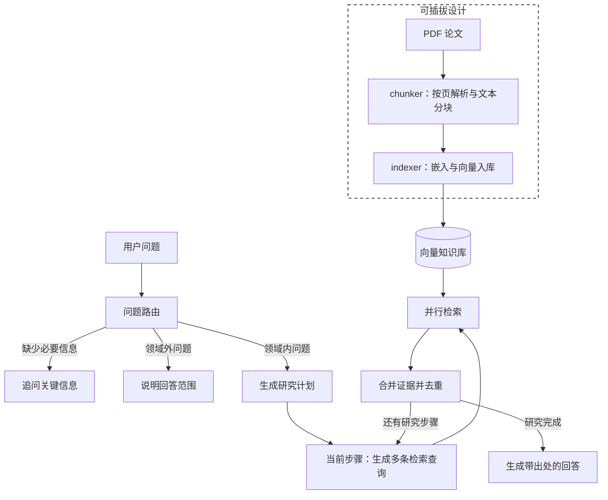
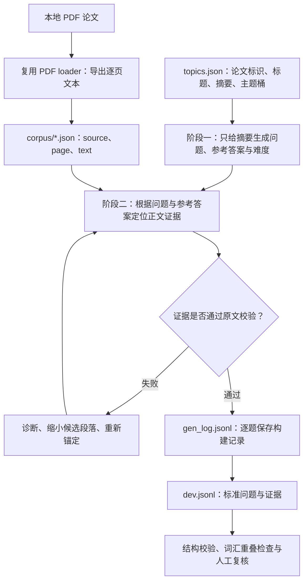
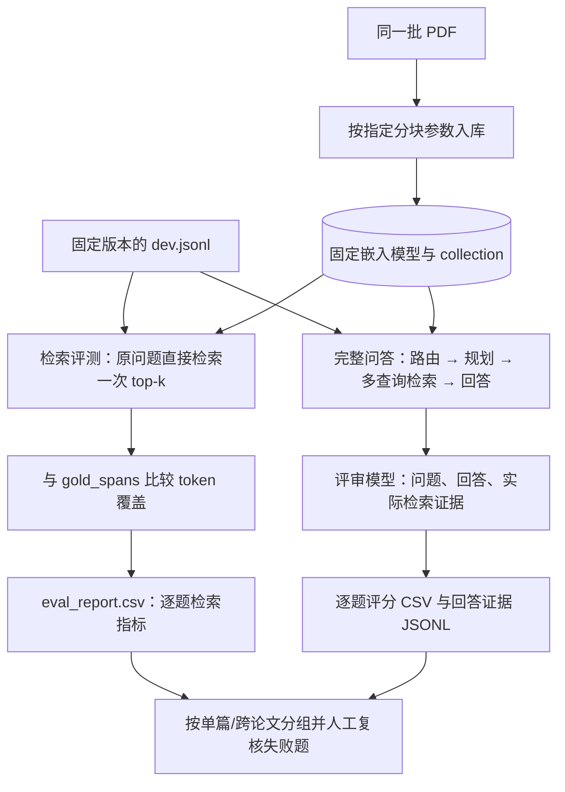

# PaperMind：科研文献 RAG 问答系统

基于 **LangGraph + LangChain** 的科研文献检索增强问答系统。将本地 PDF 论文解析、分块并写入向量库，再通过问题路由、研究计划和多查询并行检索组织证据，生成带文献出处与页码的回答。

PaperMind 最初克隆自 LangChain 官方的 LangGraph 基础模板 [retrieval-agent-template](https://github.com/langchain-ai/retrieval-agent-template.git)，并在此基础上扩展，重点实现了论文处理、本地嵌入与持久化索引、可替换的文献格式处理与分块策略，以及检索端和回答端的评测流程。当前默认知识领域为**图像超分辨与算子学习 / 神经算子**，适合围绕个人论文库开展方法分析、实验结论查询和跨论文比较。

## 核心能力

- **论文处理**：使用 PyMuPDF 按页提取 PDF 文本，过滤短碎片与参考文献部分，保留来源、页码等元数据；默认递归分块不跨页。
- **本地向量索引**：通过 sentence-transformers 运行嵌入模型，默认使用本地 Chroma 持久化存储。Chroma 入库以片段内容的 MD5 作为 ID，重复提交相同内容时执行 upsert。
- **问题路由**：区分可检索的领域问题、需要补充信息的问题，以及领域外问题，分别进入研究、追问或婉拒路径。
- **研究计划与并行检索**：将复杂问题拆成最多 5 个研究步骤，逐步执行；每步由模型生成多条查询，再通过 LangGraph `Send` 并行检索、合并去重。默认提示词要求每步生成 3 条查询。
- **基于证据回答**：将检索片段及元数据交给回答模型，提示其引用来源与页码，并在证据不足时明确说明。
- **过程可观察**：可流式查看主图的研究步骤、检索文档，以及研究子图生成的查询。
- **评测工具**：支持单篇 / 跨论文问题的证据覆盖评测，以及回答相关性、证据支持程度和引用质量的模型评审。

## 系统结构



`langgraph.json` 注册了三个可独立调用的图：`chunker`、`indexer`、`retrieval_graph`。研究子图 `researcher_graph` 由问答主图内部调用，不单独注册服务。

## 快速开始

### 1. 安装环境

项目声明支持 Python 3.10+。在仓库根目录执行：

```bash
python -m venv .venv
```

激活虚拟环境：

```powershell
# Windows PowerShell
.\.venv\Scripts\Activate.ps1
```

```bash
# macOS / Linux
source .venv/bin/activate
```

安装项目：

```bash
python -m pip install -e .
```

### 2. 配置模型与论文

将 [.env.example](.env.example) 复制为 `.env`，填写所需服务的密钥。使用 Qwen 时只需为对应模型配置：

```dotenv
QWEN_API_KEY=your-dashscope-api-key
```

Qwen 通过 DashScope 的 OpenAI 兼容接口调用。其他模型由 LangChain 模型接口加载，使用时需配置相应服务的凭据。

准备一份含可提取文本的 PDF，例如 `papers/sample.pdf`。论文文件、`.env` 和本地向量库已被 Git 忽略，需要在克隆仓库后自行准备。

**嵌入模型需要显式配置。** 当前代码默认值为开发机器上的 `E:/python_work/PDFReader_Agent/bge-m3`，通常无法在其他机器直接使用。下面示例将其覆盖为 `BAAI/bge-m3`，首次运行需要下载模型；也可以改为已下载模型的本地目录。入库与问答必须使用相同的嵌入模型、向量库目录和 collection。

### 3. 运行完整问答链路

运行仓库根目录的 `quickstart.py`。示例显式选择 `qwen/qwen3.8-max`，实际模型名称应以你的 DashScope 账号可用列表为准。

```bash
python quickstart.py
```

`chat_client_session()` 为本次 Qwen 问答共享 HTTP 客户端，并在退出前显式关闭连接，避免 Windows 下连接延迟回收导致的 `Event loop is closed`。完整的图调用或流式迭代应在该上下文内完成。

请将示例问题替换为所导入论文确实涉及的问题。更换研究领域时，也需要调整 [prompts.py](src/retrieval_graph/prompts.py) 中的领域路由提示词，或通过运行时的 `router_system_prompt` 覆盖它。

### 4. 查看研究过程

如需观察每个节点的输出，可用以下代码替换示例中的问答调用：

```python
async for namespace, update in agent.astream(
    {"messages": [("user", "SRNO 如何将神经算子用于图像超分辨？")]},
    config,
    stream_mode="updates",
    subgraphs=True,
):
    print("[主图]" if not namespace else "[研究子图]", update)
```

主图输出包含路由、研究步骤与汇总文档；子图输出包含查询和各次检索结果。`queries` 位于子图中，需要开启 `subgraphs=True` 才便于观察。

## 运行时配置

配置优先级：运行时 `config["configurable"]` > `PAPERMIND_*` 环境变量 > 代码内置默认值。项目会加载 `.env`，不覆盖已有系统环境变量。可将 `.env.example` 中的 `PAPERMIND_*` 配置复制到 `.env`，之后调用图时可省略 `config`。`PAPERMIND_SEARCH_KWARGS` 和 `PAPERMIND_SPLITTER_CONFIGURATION` 必须是 JSON 对象；运行时同名字典整体替换环境值，不递归合并。修改 `.env` 后请重启进程。

| 参数 | 当前代码默认值 | 用途 |
| --- | --- | --- |
| `retriever_provider` | `chroma` | 向量存储后端 |
| `embedding_model` | `E:/python_work/PDFReader_Agent/bge-m3` | sentence-transformers 模型名或本地路径 |
| `embedding_device` | `cpu` | 嵌入推理设备 |
| `chroma_path` | `./chroma_db` | 本地持久化目录 |
| `chroma_collection` | `langchain_index` | Chroma collection 名称 |
| `search_kwargs` | `{"k": 8}` | 每条查询的检索参数 |
| `query_model` | `qwen/qwen3.7-plus` | 路由、研究规划、查询生成及追问 / 领域外回复模型 |
| `response_model` | `qwen/qwen3.7-plus` | 基于检索证据生成最终回答的模型 |
| `loader_provider` | `pdf` | 文档加载策略 |
| `splitter_provider` | `recursive` | 文本分块策略 |
| `splitter_configuration` | `chunk_size=512`、`chunk_overlap=64` | 分块策略私有参数，默认按字符计数 |
| `min_chunk_words` | `0` | 可选的最小词数过滤，按空白分词 |
| `max_upload_bytes` | 不限制 | 传入 PDF 字节数据时的可选大小限制 |

模型默认值来自当前源码，不代表服务端一定提供同名模型；建议像快速开始示例一样显式配置可用型号。

向量后端还支持 `elastic-local`、`elastic`、`pinecone`、`mongodb`，相关连接变量见 [.env.example](.env.example)。默认本地 Chroma 路径不需要额外部署数据库服务。

## 本地 API 服务

`langgraph dev` 的内存开发服务需要 **Python 3.11+**。Python 3.10 可运行前文的 Python 图调用示例，但不能运行当前版本的内存开发服务。

如需通过本地 API 调用三个图，请在 Python 3.11+ 虚拟环境中安装项目和 CLI：

```bash
python --version
python -m pip install -e .
python -m pip install "langgraph-cli[inmem]"
langgraph dev
```

已有 Python 3.10 环境的 Windows 用户，可在安装 Python 3.11 后创建独立环境，保留原 `.venv`：

```powershell
py -3.11 -m venv .venv-api
.\.venv-api\Scripts\python.exe -m pip install --upgrade pip
.\.venv-api\Scripts\python.exe -m pip install -e . "langgraph-cli[inmem]"
$env:PYTHONUTF8 = "1"
.\.venv-api\Scripts\langgraph.exe dev
```

默认服务地址通常为 `http://127.0.0.1:2024`，以启动输出为准；API 文档位于 `/docs`。服务从 `.env` 加载 `PAPERMIND_*` 默认配置，请保持嵌入模型、向量库目录和 collection 与入库时一致；请求中的 `configurable` 可覆盖默认值。该命令启动本地开发服务，生产部署需另行配置。

## 评测集构建与真实评测流程

项目将评测拆为**证据检索评测**和**完整问答评测**：前者直接检索原问题，检查返回文本对标准证据的覆盖；后者实际运行路由、研究规划、多查询检索和回答生成，再由模型评审回答。两条路径使用同一批论文与问题，但检索调用方式不同，分数需要分别解读。

### 1. 评测集如何构建

当前完整开发集为 [evalset/dev.jsonl](evalset/dev.jsonl)，包含 **20 篇论文、100 道题**：80 道单篇题与 20 道跨论文题。单篇题每篇各有 `definition`（概念）、`method`（方法）、`synthesis`（跨章节综合）、`challenge`（局限与挑战）四类；跨论文题在同一主题桶内抽取 2–3 篇论文进行比较或综合，采样种子默认 `42`，构造时要求每篇至少参与 1 次、最多参与 4 次跨论文组合。当前数据的难度分布为 easy 20、medium 58、hard 22。



这里采用两阶段生成：先只给模型摘要，避免直接照抄正文证据来出题；再给出问题、参考答案和相关论文逐页文本，提取 **2–5 条标准证据 `gold_spans`**。每条证据保存 `{source, page, text}`，按脚本的大小写、空白与断词归一化规则检查是否为原页文本的子串。证据锚定在原始页面上，因此更改 chunk 大小或重叠长度时，可以继续用同一套标准证据比较检索效果。

每行 JSONL 的字段约定如下：

| 字段 | 含义 |
| --- | --- |
| `question` / `gold_answer` | 问题与构建阶段生成的参考答案，参考答案仍需人工核对 |
| `difficulty` / `cross_paper` | 难度与是否为跨论文题 |
| `gold_sources` | 目标论文的来源标识 |
| `gold_spans` | 标准证据列表，包含来源、从 1 开始的 PDF 页码及原文 |
| `_meta` | 单篇题的 `paper`、`slot`，或跨论文题的 `papers`，用于追踪与分组 |

在仓库根目录运行以下 PowerShell 命令。先按前文安装运行依赖、配置 `.env`，并准备对应 PDF：

```powershell
$env:PYTHONPATH = "$PWD/src"

# 导出与入库使用相同 loader 的逐页语料
python scripts/evalset_corpus.py papers

# 人工维护 evalset/topics.json 后生成完整开发集
# --model 为出题及证据锚定模型，请改为账号实际可用型号
python scripts/generate_evalset.py --seed 42 --model qwen/qwen3.7-plus

# 校验完整开发集
python scripts/evalset_validate.py
```

`topics.json` 需要维护每篇论文的 `slug`、`source`、`title`、`bucket` 和 `abstract`；`source` 必须与 corpus 及入库元数据的标识一致。已有数据保留了旧机器的绝对路径，迁移后需要同步更新 topics、corpus、评测题及索引中的来源标识。更换论文集合还需要调整生成脚本中的主题配额，以及校验脚本中固定的 80/20 规模规则。

构建过程以 `gen_log.jsonl` 为增量记录，重跑会跳过已完成项，并从成功记录重建 `dev.jsonl`。`--force` 会清空构建日志重新生成；执行前应备份已有数据。锚定失败时，可使用 [evalset_diagnose.py](scripts/evalset_diagnose.py) 检查，再用 `python scripts/evalset_reanchor.py` 对失败的单篇题缩小候选段落后重新锚定；`python scripts/evalset_trim_spans.py` 可将证据边界补齐至完整单词。这些修复脚本会改写构建产物，完成后应再次校验并人工检查证据是否足以回答问题。

校验包括必填字段、难度枚举、证据数量与原文匹配、单篇/跨论文结构、题型及组合约束，也输出问题与证据的词汇重叠警告。仓库现有 [validate_report.txt](evalset/validate_report.txt) 记录为 **100 题、0 个错误、8 个警告**；警告用于人工检查问题是否过度照搬证据。原文匹配只证明片段存在，不能替代对问题质量、参考答案正确性和跨论文推理必要性的人工审核。

### 2. 实际评测怎么运行



**准备索引与实验配置。** 用 `python scripts/index_papers.py papers` 批量入库，并确认所有论文处理成功。入库、直接检索、完整问答必须使用一致的 `PAPERMIND_EMBEDDING_MODEL`、`PAPERMIND_CHROMA_PATH` 和 `PAPERMIND_CHROMA_COLLECTION`。同时记录分块参数、`k`、查询模型、回答模型、评审模型及数据版本。比较分块策略时，为每组实验建立独立的库目录或 collection；内容 upsert 不会自动删除旧分块。

**先测直接检索，再测完整问答。** 以下命令对应真实脚本入口，使用新的报告名称保存实验结果：

```powershell
# 原问题直接检索：全部 100 题，并输出 single/cross 分组结果
python scripts/evalset_eval.py --dev evalset/dev.jsonl --k 8 --subset all
Copy-Item evalset/eval_report.csv evalset/retrieval_k8.csv

# 比较另一个 k；每次运行都会覆盖 eval_report.csv，及时另存
python scripts/evalset_eval.py --dev evalset/dev.jsonl --k 12 --subset all
Copy-Item evalset/eval_report.csv evalset/retrieval_k12.csv

# 完整问答先试跑前 5 题；--out 的父目录需已存在
python scripts/eval_generation.py --dev evalset/dev.jsonl --limit 5 --out evalset/run_smoke

# 完整跑完 100 题；--limit 0 表示全部
python scripts/eval_generation.py --dev evalset/dev.jsonl --limit 0 --out evalset/run_full

# 已有 10 道跨论文 + 10 道单篇的较小评测集，也可单独运行
python scripts/eval_generation.py --dev evalset/dev_10c10s.jsonl --limit 0 --out evalset/run_10c10s
```

`--limit` 按文件顺序取题，不做随机或分层抽样；当前完整集前面的题为跨论文题，因此前 5 题只适合检查链路。完整问答使用当前配置中的查询、回答模型及检索参数；`--judge-model` 可单独指定评审模型。直接检索脚本的 `--k` 只影响本次直接检索，完整问答的检索参数需要通过 `PAPERMIND_SEARCH_KWARGS` 等运行配置设置。

生成评测逐题追加到 `<out>_detail.jsonl`，并汇总为 `<out>_report.csv`，记录路由类型及理由、文档数量、图与评审耗时、三项评分、评分理由和错误。再次使用同一 `--out` 会按 `pair_id` 跳过已有记录，**错误记录也会被跳过**；`--force` 可重跑所选题目，但仍追加明细，汇总时同一 ID 取最后记录。改变配置、题目或评审模型时应使用新的 `--out`，避免把不同实验混进同一份报告；汇总范围是整个 checkpoint，并不只限于本次 `--limit` 选中的题。

### 3. 指标口径与结果复核

| 评测项 | 实际计算或评审方式 | 解读边界 |
| --- | --- | --- |
| `recall@k` / CSV 的 `hitrate` | 每条 gold span 的不同 token 被 top-k 文本 token 并集覆盖的比例；先对题内所有 span 平均，再对题目平均 | 项目定义的词汇证据覆盖率，不是标准的相关文档召回率 |
| `coverage_best` | 一题中覆盖率最高的 gold span | 仅反映最好的一条证据，不能代替整题覆盖 |
| 有效命中率 | 与任意 gold span 有 token 交集的 chunk 数量之和，除以题数乘 `k` | 条件宽松，普通词也能贡献命中，不能当作严格的检索精确率 |
| `relevance` | 回答是否回应问题，1–5 分 | 模型评审 |
| `grounded` | 回答事实是否有实际检索证据支持，1–5 分 | 模型评审 |
| `citation` | 来源、页码是否存在，引用内容是否支持对应论断，1–5 分 | 模型评审 |

直接检索评分只比较归一化后的英文字母/数字 token 集合，**没有用 `source` 或 `page` 限制匹配**；来自其他论文的相同词汇也可能提高分数。跨论文题将各论文的 spans 合并后取平均，并未额外强制“每篇都命中”。因此需要结合来源、页码与原文人工复核，尤其关注跨论文证据缺失。

回答评审实际只接收问题、回答和检索证据，**不使用 `gold_answer` 或 `gold_spans` 评分**。传给评审模型的证据最多为前 25 个文档，每段最多 1500 字符；回答若引用了截断范围外的内容，需要回查完整检索结果和 PDF。建议同时报告成功数、失败数、路由分布及 single/cross 分组分数，逐题查看低分回答的 `rationale` 和证据，区分路由偏差、检索缺失、生成错误、引用错误及服务超时。当前整图超时为 600 秒，单次评审超时为 120 秒，超时会记录在 `error` 中。

### 4. 仓库已有的真实评测记录

以下数字直接汇总自当前仓库 CSV，属于**已有实验快照**。本次文档补充未重新调用模型或重建索引；报告没有完整固化当时的模型、索引及提示词配置，不能据此宣称当前版本在相同条件下必然复现这些分数。

| 报告 | 样本范围 | 已有结果 |
| --- | --- | --- |
| [eval_report.csv](evalset/eval_report.csv) | 100 题，`k=8`；单篇 80、跨论文 20 | 单篇证据覆盖率 **83.87%**，跨论文 **70.07%**；有效命中率分别为 **99.69%**、**100%**，需结合上述宽松指标口径解读 |
| [eval_generation_report.csv](evalset/eval_generation_report.csv) | 20 道跨论文题，20 题成功、0 题错误 | relevance **4.75**、grounded **4.10**、citation **4.10** |

这些报告使用不同题目范围，不能直接当作模型改进的前后对照；当前生成报告也不构成全部 100 题的完整问答成绩。构建与调参使用的是开发集，若用于正式效果结论，建议另留固定、未经调参使用的测试集，并补充人工核验。生成评测与评测集生成都会调用模型接口，运行前需确认模型可用性与费用；报告可能包含论文原文和本地路径，分享前请检查。

## 测试

单元测试可使用：

```bash
python -m pip install pytest pytest-asyncio
python -m pytest tests/unit_tests -q
```

集成测试需要相应的 PDF、嵌入模型、模型服务或向量数据库。部分集成用例沿用原始模板的 LangChain 领域问题，与当前科研领域路由不同，不能直接作为当前论文库的完整验收标准。完整链路的检查思路见 [how2test.md](how2test.md)。

## 目录结构

```text
src/
├── chunk_graph/                 # PDF 加载、分块、策略注册与元数据处理
├── index_graph/                 # 文档嵌入与向量入库
├── retrieval_graph/             # 问题路由、研究规划、最终回答
│   └── researcher_graph/        # 查询生成与并行检索子图
└── shared/                     # 配置、嵌入、检索、状态 reducer 与工具
scripts/                        # 批量入库、评测集处理及评测脚本
evalset/                        # 评测问题、语料及评测报告
tests/                          # 单元测试与集成测试
langgraph.json                  # 图注册与本地开发服务配置
.env.example                    # 环境变量示例
```

`scripts/index_papers.py` 可批量处理指定目录下的 `*.pdf`，但当前采用源码默认配置；使用前需确认默认嵌入模型路径适用于本机。自定义加载器与分块器的扩展说明见 [ADD_CHUNKER.md](ADD_CHUNKER.md)，实际参数名以当前源码为准（`loader_configuration`、`splitter_configuration`）。

## 当前边界

- 项目主要提供 Python 图调用、开发服务及评测脚本，尚未提供独立的文献管理与聊天前端。
- PDF 处理依赖文本层，没有 OCR；过滤逻辑更适合英文论文，扫描件、复杂双栏版式、公式和表格可能产生缺失或顺序问题。
- 回答引用由模型根据检索元数据生成，仍需核对；标题、作者和年份的完整性取决于 PDF 元数据或调用方传入的信息，未实现自动书目补全。
- 当前检索主要基于稠密向量，未实现 BM25 混合检索或独立 reranker。
- 内容去重基于文本 MD5；更新论文或更换分块参数不会自动清理旧片段。同一文本在多个来源中出现时也可能合并，需要结合实际索引管理策略处理。

## 来源与许可证

PaperMind 最初克隆自 LangChain 官方的 LangGraph 基础模板 [langchain-ai/retrieval-agent-template](https://github.com/langchain-ai/retrieval-agent-template.git)，随后面向科研文献场景进行扩展。项目遵循 [MIT License](LICENSE)，保留原始模板的版权与许可声明。
